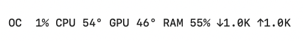
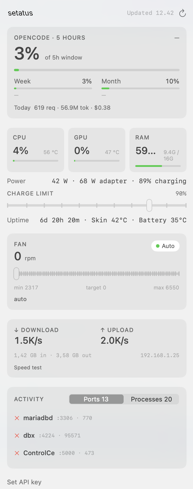

<div align="center">

# Setatus

**A native macOS menu bar monitor for OpenCode usage, system load, fans, and battery charge.**

[](#requirements)
[](#requirements)
[](#requirements)
[](LICENSE)
[](CHANGELOG.md)
[](https://github.com/albae69/setatus)
[](https://github.com/albae69/setatus)

</div>

Setatus is a small, dependency-free AppKit + SwiftUI app that keeps the numbers you care
about in the macOS menu bar. It reads OpenCode usage limits, CPU/GPU/RAM load, fan speed,
network throughput, temperatures, and power input directly from the system — no agents,
no telemetry. The only background service is the fan helper daemon, installed once and
kept idle until a manual fan target or charge limit is set.

```text
OC 42% CPU 12% GPU 13% RAM 62% 2.4k ↓1.2M ↑240K
 limit  cpu   gpu   ram   fan   net
```

Click the status item for details. Right-click it for actions.

<div align="center">
  
  <br><br>
  
</div>

<div align="center">
  <sub>Made by <a href="https://github.com/albae69">albae69</a></sub>
</div>

---

## Table of contents

- [Features](#features)
- [Requirements](#requirements)
- [Build from source](#build-from-source)
- [Usage](#usage)
- [Configuration](#configuration)
- [How it works](#how-it-works)
- [Fan and charge control](#fan-and-charge-control)
- [Privacy and security](#privacy-and-security)
- [Command line](#command-line)
- [Project structure](#project-structure)
- [Troubleshooting](#troubleshooting)
- [Limitations](#limitations)
- [Changelog](#changelog)
- [Contributing](#contributing)
- [License](#license)

## Features

### Menu bar

| Field | Description |
| --- | --- |
| OpenCode limit | Rolling 5-hour window usage |
| CPU | Current CPU utilization |
| GPU | GPU device utilization |
| RAM | Memory used, as a percentage |
| Fan | Current fan speed, compact (`2.4k` for 2400 rpm) |
| Network | Download and upload rate |
| Power | Optional system power input in watts |

Every field is padded to a fixed width and rendered with a monospaced font, so the status
item does not shift while values change. Fields can be enabled or disabled individually
from the right-click menu; the power input metric is off by default.

When the menu bar runs out of room (notch or too many items), the item collapses to the
app icon (plain `S` if the bundle has no icon) instead of disappearing. The full title is
still available as a tooltip, and clicking the icon opens the popover as usual.

### Popover

The panel is 356 pt wide, drawn as flat, hard-edged cards with ink strokes and offset
shadows on one cream surface, and sized so every card fits on screen without scrolling:

- **OpenCode limits** — the 5-hour window as the hero number with its reset countdown,
  weekly and monthly windows as secondary columns, plus today's requests, input/output
  tokens, cache read/write, hit rate, and cost totals.
- **System** — CPU, GPU, and RAM as three tiles with usage, temperature (RAM shows
  used/total), and a block meter; power input, uptime, and extra sensors as info lines.
- **Fan** — live RPM, an Auto/Manual pill, a slider clamped to the SMC range, min/target/max
  labels, and an Auto button while manual control is active.
- **Charge limit** — the target percent as a hero number, a Paused/SMC limit pill, and a
  slider (root helper holds the battery at the set percent via SMC).
- **Internet** — download/upload speed side by side, cumulative totals since boot, the
  local IPv4 address, and a **Speed test** button (Cloudflare download/upload, Mbps).
- **Activity** — one card with a **Ports / Processes** segmented switch. Ports lists every
  process listening on a TCP port; Processes lists
  the top 20 by RAM. Both use the same inline **SIGTERM?** confirmation before killing.
- **API key** — optional manual override for the OpenCode key; the header shows the last
  update time and a refresh button.

### Menu actions

Right-click (or Control-click) the status item:

| Action | Description |
| --- | --- |
| Refresh | Reload usage and processes |
| Menu Bar | Toggle metrics, pick CPU/GPU percent or temperature, or reset to defaults |
| Launch at Login | Install or remove a `~/Library/LaunchAgents` login item |
| About Setatus | App name, icon, version, and author |
| Uninstall Setatus… | Remove the fan helper, login item, config, and `Setatus.app`, then confirm |
| Quit Setatus | Restore the fan and exit |

## Requirements

- macOS 13 Ventura or newer
- Swift 5.9 toolchain (Xcode Command Line Tools)
- Apple Silicon recommended
- No third-party packages

Fan control depends on the SMC exposing writable fan keys. It has been tested on an
Apple M4 MacBook Pro (`Mac16,1`); other models may behave differently.

## Build from source

```sh
git clone https://github.com/albae69/setatus.git
cd setatus

bash scripts/build-app.sh
open Setatus.app
```

The build script:

1. Runs `swift build -c release`.
2. Assembles `Setatus.app` with `Contents/MacOS` and `Contents/Resources`.
3. Generates `Info.plist` (`dev.bae.setatus`, `LSUIElement`).
4. Copies `Assets/AppIcon.icns`.
5. Ad-hoc signs the bundle with `codesign --force --sign -`.

To keep it in Applications:

```sh
ditto Setatus.app /Applications/Setatus.app
open /Applications/Setatus.app
```

There is no DMG and no notarization. Because the bundle is ad-hoc signed, Gatekeeper may
warn on first launch — open it from Finder with **Open** if that happens.

## Usage

1. Launch `Setatus.app`. It appears in the menu bar and does not show a Dock icon.
2. Click the status item to open the popover.
3. Right-click to choose which metrics appear, enable launch at login, or quit.
4. To control the fan, drag the slider in the **Fan** card. The first time, Setatus installs
   the root fan helper and asks for an administrator password once; later changes only write
   a request file. Picking **Auto** (or quitting) returns the fan to the system.
5. To hold the battery at a given charge, drag the slider in the **Charge limit** card. Set it to 100 (or **off**) to resume normal charging.
6. Right-click → **Uninstall Setatus…** stops the helper, removes the login item and config,
   and deletes the app once you confirm.

## Configuration

| Setting | Where |
| --- | --- |
| Menu bar metrics | Right-click → **Menu Bar** (stored in `UserDefaults` under `menuMetrics`) |
| Launch at login | Right-click → **Launch at Login** (`~/Library/LaunchAgents/dev.bae.setatus.plist`) |
| OpenCode API key | Automatically read from 9router or OpenCode, or entered manually via **Set API Key…** |
| Charge limit | Popover slider (stored in `UserDefaults` under `chargeLimit`, 100 means off) |
| Fan helper | `/Library/LaunchDaemons/dev.bae.setatus.fanhelper.plist` and `/Library/PrivilegedHelperTools/dev.bae.setatus.fanhelper` |
| Fan and charge requests | `~/.config/setatus/fan.json` and `charge.json`, logs in `~/.config/setatus/helper.log` |

Setatus reads the OpenCode key from `~/.9router/db/data.sqlite`
(`providerConnections` where `provider = 'opencode-go'`). Without 9router it falls back to
the credential OpenCode stores directly in `~/.local/share/opencode/opencode.db`
(`credential` where `integration_id = 'opencode'`), skipping OAuth tokens that have already
expired. A manually entered key is stored in `UserDefaults` and takes precedence.

## How it works

| Reading | Source |
| --- | --- |
| CPU usage | `host_statistics` |
| RAM usage | `host_statistics64` |
| GPU usage | `ioreg -c IOAccelerator` → `PerformanceStatistics["Device Utilization %"]` |
| Temperatures, fans | AppleSMC via IOKit |
| Network rate and totals | `sysctl` `NET_RT_IFLIST2` |
| Local IP address | `getifaddrs`, preferring `en0` |
| Power input | `AppleSmartBattery` → `PowerTelemetryData.SystemPowerIn` (mW) |
| Battery state | `IOPSCopyPowerSourcesInfo` |
| Charge limit | SMC charging key (`CHTE`, `CH0B`, or `CHWA`) via the root helper |
| Uptime | `sysctl` `KERN_BOOTTIME` |
| OpenCode usage | `GET https://opencode.ai/zen/go/v1/usage` |
| Today's usage | OpenCode local service (`/api/experimental/session/stats`), falling back to 9router `usageDaily` |
| Speed test | `https://speed.cloudflare.com/__down` and `__up` |

The app uses a single `NSStatusItem` with a custom font and an `NSPopover` for the panel.
Metrics refresh every 2 seconds, processes every 5 seconds, and OpenCode usage every
minute.

Today's requests, tokens, and model breakdown come from OpenCode's local service
(`~/.local/state/opencode/service.json`), which aggregates every session regardless of
provider, so a mix of 9router and direct OpenCode traffic is counted once. When that service
is not running, Setatus falls back to 9router's `usageDaily` table. Costs reported by
OpenCode are used as-is, so they read `$0.00` on a subscription plan.

## Fan and charge control

Fan and charge control require root, so Setatus installs a small launchd daemon **once**:

```text
/Library/PrivilegedHelperTools/dev.bae.setatus.fanhelper --fan-daemon <home>
/Library/LaunchDaemons/dev.bae.setatus.fanhelper.plist   (RunAtLoad, KeepAlive)
```

The first fan target or charge limit triggers one administrator prompt that copies the app
binary and the plist as `root:wheel`, then bootstraps the job. After that, changing the fan
slider only writes `~/.config/setatus/fan.json` and sends a heartbeat every 2 seconds, and
changing the charge limit only writes `charge.json` — no password.
The install is repeated once (same single prompt) after an app update, because `installed`
compares the SHA-256 of the bundle binary with the installed helper.

The daemon:

- clamps the target to the SMC minimum and maximum,
- unlocks manual mode with `Ftst = 1` when the model requires it,
- re-asserts control after wake,
- **idles** on an invalid, missing, or stale request, restores automatic mode, and keeps
  running for the next request (a single bad read no longer kills it),
- rejects symlinked request files, files outside `~/.config/setatus`, oversized files, and
  fan indices without a matching SMC key,
- appends start, engage, target, idle, and exit reasons to `~/.config/setatus/helper.log`,
- writes installer output to `~/.config/setatus/install.log`.

The same daemon applies the charge limit: it pauses charging when the battery reaches the
chosen percent and resumes 2 points below it, writes `charge-state.json` for the popover,
and releases the SMC key when the limit is set back to 100. The limit applies only while a
fresh `charge.json` request exists, so the app re-sends it every 2 seconds while a limit is
active, and the daemon reads the SMC key back each tick to rewrite it if the firmware
drifted. The key is `CHTE` (`ui32`) on current Apple Silicon firmware, or `CHWA`/`CH0B`
(`ui8`) on older ones; machines without one get a disabled slider and a note.

Quitting Setatus writes `rpm = 0`, so the fan returns to automatic control immediately.

> [!WARNING]
> Manual fan mode uses the SMC diagnostic key `Ftst`, which suppresses normal thermal
> management while engaged. Watch your temperatures and return to **Auto** when you are
> done. Use at your own risk.

## Privacy and security

- No telemetry or analytics.
- Outbound requests go to `opencode.ai` for usage data, and to `speed.cloudflare.com` only
  when you press **Speed test**. No other third-party service is contacted.
- The fan helper is a root-owned launchd job. It stays resident but touches the SMC only
  while a fresh fan or charge request exists, always restores automatic fan mode when the
  request goes stale, and accepts requests only from a regular file in `~/.config/setatus`.
- A manually entered API key is stored in `UserDefaults` in plain text. Prefer the 9router
  database key if you keep secrets out of app preferences.

## Command line

```sh
./Setatus.app/Contents/MacOS/Setatus --selfcheck  # print sensor, network, and usage readings
./Setatus.app/Contents/MacOS/Setatus --killtest   # verify process termination
./Setatus.app/Contents/MacOS/Setatus --open-panel # start with the popover open
./Setatus.app/Contents/MacOS/Setatus --charge     # list charge keys and check limit hysteresis
./Setatus.app/Contents/MacOS/Setatus --charge-write # probe the charge key write/read/release (root only)
./Setatus.app/Contents/MacOS/Setatus --smc        # dump charging-related SMC keys
./Setatus.app/Contents/MacOS/Setatus --speedtest  # run the Cloudflare speed test
```

`--fan-daemon <home>` is the installed launchd helper entry point (`--fan-hold <home>` is
the legacy foreground form).

## Project structure

```text
Sources/Setatus/
  SetatusApp.swift    @main, NSStatusItem, popover, menu, About
  Model.swift         observable state, timers, menu bar title, metric selection
  Views.swift         SwiftUI popover layout
  Sensors.swift       SMC access: temperatures, fans, key read/write
  FanControl.swift    root helper, request files, fan restore
  Charge.swift        battery charge limit request and state
  Metrics.swift       CPU and RAM sampling
  GPU.swift           GPU utilization
  Network.swift       interface counters and local IP
  Power.swift         power input, adapter, battery
  Processes.swift     process list and SIGTERM
  Ports.swift         dev port scan and killer
  Usage.swift         OpenCode limits and today's stats
  LaunchAtLogin.swift LaunchAgent login item
  Fmt.swift           adaptive, fixed-width number formatting
  Shell.swift         process runner helper
  SelfCheck.swift     command line checks
scripts/build-app.sh  app bundle build
Assets/AppIcon.icns   Finder icon
Assets/icon-app-s-ribbon.vectorcraft  App icon source (VectorCraft)
Assets/menu-bar.png   Menu bar screenshot
Assets/popover.png    Popover screenshot
```

## Troubleshooting

**The app does not appear in the menu bar.**
Check that `LSUIElement` is set in the built `Info.plist` and that no other copy is
already running. Setatus exits when another instance with the same executable path is
active.

**Menu bar numbers shift.**
Fields are padded deliberately. If you added a metric, keep its formatted width constant
or reuse `Fmt.pad`.

**Fan control does nothing.**
Some Apple Silicon models ignore SMC fan writes. Run `--selfcheck` and confirm that
`F0Md`, `F0Tg`, and `Ftst` exist and are writable. Also confirm the daemon is loaded and
running:

```sh
pgrep -f -- --fan-daemon
launchctl print system/dev.bae.setatus.fanhelper | head
```

**Usage shows "No OpenCode API key found".**
Add an `opencode-go` connection in 9router (`~/.9router/db/data.sqlite`), sign in to
OpenCode, or set the key manually via **Set API Key…**.

**The password prompt appears again.**
Expected on the first manual target, and once after an app update (the helper binary is a
root-owned copy, refreshed by hash). If it keeps prompting, the daemon is not staying up.
Check:

```sh
launchctl print system/dev.bae.setatus.fanhelper | head
cat ~/.config/setatus/install.log
tail -20 ~/.config/setatus/helper.log
```

Delete the helper to force a clean reinstall on the next manual target:

```sh
sudo rm -f /Library/LaunchDaemons/dev.bae.setatus.fanhelper.plist \
  /Library/PrivilegedHelperTools/dev.bae.setatus.fanhelper
```

## Limitations

- Fan control is hardware-dependent.
- Charge limiting is hardware-dependent: the SMC must expose `CHTE`, `CH0B`, or `CHWA`.
  The slider shows a message and stays disabled when no key exists.
- GPU utilization is only available when the accelerator exposes
  `Device Utilization %`.
- Network totals are kernel counters since boot, summed over non-loopback interfaces.
- Single-instance detection compares resolved executable paths rather than using a
  system-wide lock.
- The fan helper is a copy of the app binary, so an app update needs one admin prompt to
  refresh it (handled automatically on the next manual target).
- The app is not notarized and has no installer.

## Changelog

Release history and notable changes are in [CHANGELOG.md](CHANGELOG.md).

## Contributing

Issues and pull requests are welcome. Keep changes small and consistent with the existing
style, and run the self-check before submitting:

```sh
swift build -c release
./.build/release/Setatus --selfcheck
bash scripts/build-app.sh
```

## License

MIT — see [LICENSE](LICENSE).

Copyright (c) 2026 bae.
