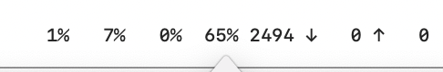
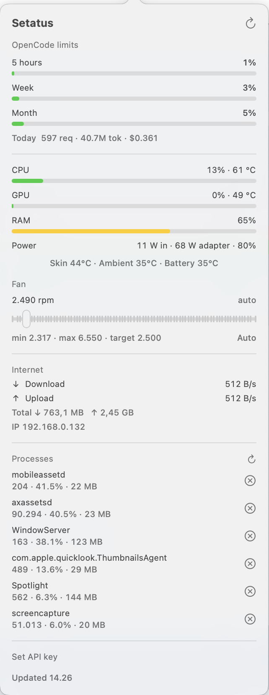

<div align="center">

# Setatus

**A native macOS menu bar monitor for OpenCode usage, system load, and fans.**

[](#requirements)
[](#requirements)
[](#requirements)
[](LICENSE)


</div>

Setatus is a small, dependency-free AppKit + SwiftUI app that keeps the numbers you care
about in the macOS menu bar. It reads OpenCode usage limits, CPU/GPU/RAM load, fan speed,
network throughput, temperatures, and power input directly from the system — no agents,
no telemetry, no background services beyond an optional privileged fan helper.

```text
  1%   12%   13%   62%  2400  ↓1.2M ↑240K
 limit  cpu   gpu   ram   fan   net
```

Click the status item for details. Right-click it for actions.

<div align="center">
  
  <br><br>
  
</div>

<div align="center">
  <sub>Made by bae</sub>
</div>

---

## Table of contents

- [Features](#features)
- [Requirements](#requirements)
- [Build from source](#build-from-source)
- [Usage](#usage)
- [Configuration](#configuration)
- [How it works](#how-it-works)
- [Fan control](#fan-control)
- [Privacy and security](#privacy-and-security)
- [Command line](#command-line)
- [Project structure](#project-structure)
- [Troubleshooting](#troubleshooting)
- [Limitations](#limitations)
- [Contributing](#contributing)
- [License](#license)

## Features

### Menu bar

| Field | Description |
| --- | --- |
| OpenCode limit | Rolling 5-hour window usage |
| CPU | Current CPU utilization |
| GPU | GPU device utilization |
| RAM | Memory used, as a percentage |
| Fan | Current fan speed in RPM (number only) |
| Network | Download and upload rate |
| Power | Optional system power input in watts |

Every field is padded to a fixed width and rendered with a monospaced font, so the status
item does not shift while values change. Fields can be enabled or disabled individually
from the right-click menu; the power input metric is off by default.

### Popover

- **OpenCode limits** — 5-hour, weekly, and monthly percentages with reset countdowns,
  plus today's request, token, and cost totals.
- **CPU / GPU / RAM** — live usage, temperature readings, and meter bars.
- **Power** — system power input (`SystemPowerIn`), negotiated adapter wattage, battery
  percentage, and charging state.
- **Fan** — live RPM, min/max/target values, a manual-control slider clamped to the SMC
  range, and an Auto button.
- **Internet** — download/upload speed, cumulative totals since boot, and the local IPv4
  address.
- **Processes** — top six processes by CPU with a two-step SIGTERM confirmation.
- **API key** — optional manual override for the OpenCode key.

### Menu actions

Right-click (or Control-click) the status item:

| Action | Description |
| --- | --- |
| Refresh | Reload usage and processes |
| Fan Auto | Return fan control to the system |
| Menu Bar | Toggle individual menu bar metrics |
| Launch at Login | Register or unregister with `SMAppService` |
| About Setatus | App name, icon, version, and author |
| Quit Setatus | Restore the fan and exit |

## Requirements

- macOS 13 Ventura or newer
- Swift 5.9 toolchain (Xcode Command Line Tools)
- Apple Silicon recommended
- No third-party packages

Fan control depends on the SMC exposing writable fan keys. It has been tested on an
Apple M4 MacBook Pro (`Mac16,1`); other models may behave differently.

## Build from source

```sh
git clone <your-repo-url> setatus
cd setatus

bash scripts/build-app.sh
open Setatus.app
```

The build script:

1. Runs `swift build -c release`.
2. Assembles `Setatus.app` with `Contents/MacOS` and `Contents/Resources`.
3. Generates `Info.plist` (`dev.bae.setatus`, `LSUIElement`).
4. Copies `Assets/AppIcon.icns`.
5. Ad-hoc signs the bundle with `codesign --force --sign -`.

There is no DMG and no notarization. Because the bundle is ad-hoc signed, Gatekeeper may
warn on first launch — open it from Finder with **Open** if that happens.

## Usage

1. Launch `Setatus.app`. It appears in the menu bar and does not show a Dock icon.
2. Click the status item to open the popover.
3. Right-click to choose which metrics appear, enable launch at login, or quit.
4. To control the fan, drag the slider in the **Fan** section. Setatus asks for an
   administrator password once, then keeps control until you select **Auto** or quit.

## Configuration

| Setting | Where |
| --- | --- |
| Menu bar metrics | Right-click → **Menu Bar** (stored in `UserDefaults` under `menuMetrics`) |
| Launch at login | Right-click → **Launch at Login** |
| OpenCode API key | Automatically read from 9router, or enter one in the popover |

Setatus reads the OpenCode key from `~/.9router/db/data.sqlite`
(`providerConnections` where `provider = 'opencode-go'`). A manually entered key is stored
in `UserDefaults`.

## How it works

| Reading | Source |
| --- | --- |
| CPU usage | `host_statistics` |
| RAM usage | `host_statistics64` |
| GPU usage | `ioreg -c IOAccelerator` → `PerformanceStatistics["Device Utilization %"]` |
| Temperatures, fans | AppleSMC via IOKit |
| Network rate and totals | `sysctl` `NET_RT_IFLIST2` |
| Local IP address | `getifaddrs`, preferring `en0` |
| Power input | `AppleSmartBattery` → `PowerTelemetryData.SystemPowerIn` (mW) |
| Battery state | `IOPSCopyPowerSourcesInfo` |
| OpenCode usage | `GET https://opencode.ai/zen/go/v1/usage` |
| Today's usage | 9router `usageDaily` table |

The app uses a single `NSStatusItem` with a custom font and an `NSPopover` for the panel.
Metrics refresh every 2 seconds, processes every 5 seconds, and OpenCode usage every
minute.

## Fan control

Fan control requires root. Setatus prompts for an administrator password **once** per
helper lifetime, then starts a persistent helper:

```text
Setatus --fan-hold ~    (launched through osascript with administrator privileges)
```

The app writes the requested target to `~/.config/setatus/fan.json` and sends a heartbeat
every 2 seconds. The helper:

- clamps the target to the SMC minimum and maximum,
- unlocks manual mode with `Ftst = 1` when the model requires it,
- re-asserts control after wake,
- restores automatic mode and exits when the request is older than 30 seconds or
  `rpm = 0`,
- rejects symlinked request files, files outside `~/.config/setatus`, and fan indices
  without a matching SMC key.

Quitting Setatus writes `rpm = 0`, so the fan returns to automatic control immediately.

> [!WARNING]
> Manual fan mode uses the SMC diagnostic key `Ftst`, which suppresses normal thermal
> management while engaged. Watch your temperatures and return to **Auto** when you are
> done. Use at your own risk.

## Privacy and security

- No telemetry, analytics, or third-party services.
- The only outbound request is to `opencode.ai` for usage data.
- The fan helper runs only while manual control is active and always restores automatic
  mode on exit or timeout.
- A manually entered API key is stored in `UserDefaults` in plain text. Prefer the 9router
  database key if you keep secrets out of app preferences.

## Command line

```sh
./Setatus.app/Contents/MacOS/Setatus --selfcheck  # print sensor, network, and usage readings
./Setatus.app/Contents/MacOS/Setatus --killtest   # verify process termination
./Setatus.app/Contents/MacOS/Setatus --open-panel # start with the popover open
```

`--fan-hold <home>` is the internal privileged helper entry point.

## Project structure

```text
Sources/Setatus/
  SetatusApp.swift    @main, NSStatusItem, popover, menu, About
  Model.swift         observable state, timers, menu bar title, metric selection
  Views.swift         SwiftUI popover layout
  Sensors.swift       SMC access: temperatures, fans, key read/write
  FanControl.swift    root helper, request file, fan restore
  Metrics.swift       CPU and RAM sampling
  GPU.swift           GPU utilization
  Network.swift       interface counters and local IP
  Power.swift         power input, adapter, battery
  Processes.swift     process list and SIGTERM
  Usage.swift         OpenCode limits and today's stats
  LaunchAtLogin.swift SMAppService registration
  Fmt.swift           adaptive, fixed-width number formatting
  Shell.swift         process runner helper
  SelfCheck.swift     command line checks
scripts/build-app.sh  app bundle build
Assets/AppIcon.icns   Finder icon
Assets/menu-bar.png   Menu bar screenshot
Assets/popover.png    Popover screenshot
```

## Troubleshooting

**The app does not appear in the menu bar.**
Check that `LSUIElement` is set in the built `Info.plist` and that no other copy is
already running. Setatus exits when another instance with the same executable path is
active.

**Menu bar numbers shift.**
Fields are padded deliberately. If you added a metric, keep its formatted width constant
or reuse `Fmt.pad`.

**Fan control does nothing.**
Some Apple Silicon models ignore SMC fan writes. Run `--selfcheck` and confirm that
`F0Md`, `F0Tg`, and `Ftst` exist and are writable. Also confirm the helper is running:

```sh
pgrep -f -- --fan-hold
```

**Usage shows "No opencode-go key found".**
Make sure 9router has an `opencode-go` connection in
`~/.9router/db/data.sqlite`, or enter the key manually in the popover.

## Limitations

- Fan control is hardware-dependent.
- GPU utilization is only available when the accelerator exposes
  `Device Utilization %`.
- Network totals are kernel counters since boot, summed over non-loopback interfaces.
- Single-instance detection compares resolved executable paths rather than using a
  system-wide lock.
- The app is not notarized and has no installer.

## Contributing

Issues and pull requests are welcome. Keep changes small and consistent with the existing
style, and run the self-check before submitting:

```sh
swift build -c release
./.build/release/Setatus --selfcheck
bash scripts/build-app.sh
```

## License

MIT — see [LICENSE](LICENSE).

Copyright (c) 2026 bae.
